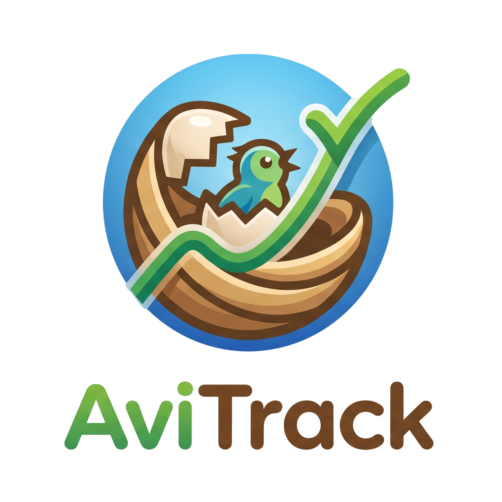

# 🕊️ AviTrack - Gestión Avanzada de Cría de Aves

AviTrack es una aplicación moderna y profesional diseñada para criadores de aves que buscan un control total sobre sus nidadas. Con un diseño elegante y herramientas inteligentes, AviTrack te ayuda a que ningún nacimiento te pille por sorpresa.



## ✨ Características Principales

*   **📊 Seguimiento de Nidadas:** Registra la puesta de huevos, el inicio de la incubación y la fecha prevista de eclosión.
*   **⏳ Margen Extra Personalizable:** Configura días de margen adicionales tras la eclosión para cada nidada individualmente. ¡Tú decides cuánto esperar!
*   **🔔 Notificaciones Inteligentes:** Alarmas automáticas para avisarte de cada huevo y del día del nacimiento, siempre a las 09:00 AM.
*   **📖 Diccionario de Especies:** Base de datos editable con los tiempos de incubación y márgenes por defecto para canarios, periquitos y más.
*   **🌓 Modo Oscuro Dinámico:** Elige entre modo Claro, Oscuro o deja que la app siga automáticamente la configuración de tu móvil.
*   **🍳 Contador de Huevos:** Suma o resta huevos en tiempo real durante la fase de puesta con un solo toque.

## 🛠️ Instalación y Compilación

AviTrack está construido con **Flutter** y utiliza **Isar Database** para un almacenamiento ultra rápido y local.

### Requisitos
*   Flutter SDK (v3.41 o superior recomendado)
*   Android SDK 34+

### Compilación
Para generar tu propia APK de lanzamiento:
```powershell
flutter build apk --release
```
El archivo generado se encontrará en: `build\app\outputs\flutter-apk\app-release.apk`

## 📱 Capturas de Pantalla
*(Próximamente)*

---
Desarrollado con ❤️ para criadores apasionados.
